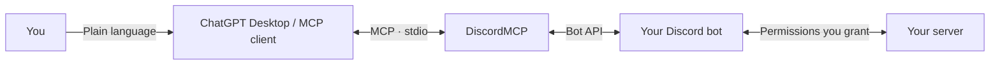

<div align="center">

# DiscordMCP

### Your server. Your bot. Manage it in plain language.

[Русский](README.md) · **English**


[](https://nodejs.org/)
[](https://modelcontextprotocol.io/)
[](https://discord.com/developers/applications)

Connect a Discord bot you create to ChatGPT Desktop, Codex, or another MCP client, then manage your server through your assistant.

</div>

## How it works

**DiscordMCP is a bridge between an AI assistant and the official Discord API.** Create your own bot, invite it to your server and save its token locally. The bridge exposes tools that let your assistant act through that bot.



Your bot does not need prewritten commands or application logic: a Discord application and Bot Token are enough. REST operations do not require a persistent Gateway connection; voice and event tools connect on demand. The AI model runs in your MCP client. DiscordMCP does not require a separate OpenAI API key.

## Things to ask

> “Give my server a space theme: propose categories, channel names, role colors, a welcome message and rules. Show me the plan first.”

> “Inspect the current channels and roles. Suggest a polished layout without deleting existing content or changing access permissions.”

> “Create an announcements channel and format the rules as an embed. Use welcome.png from the assets folder.”

| Area | Capabilities |
| --- | --- |
| Design | Name, icon, banner, roles, colors, emoji, stickers, welcome screen, onboarding |
| Structure | Categories, text and voice channels, permissions, forums, threads |
| Messages | Reading, search, embeds, components, attachments, replies, pins |
| Administration | Members, roles, timeouts, kick/ban, AutoMod, audit |
| Community | Events, polls, webhooks, application commands |
| Voice | Join, local audio, queue, pause, soundboard |

Capabilities depend on the bot's permissions, role hierarchy, intents and Discord restrictions. For example, a server banner requires that feature to be available to the server itself.

## 1. Create your own bot

1. Open the [Discord Developer Portal](https://discord.com/developers/applications) and select **New Application**.
2. On the **Bot** page, create a bot if needed and obtain its **Bot Token**. Use a bot token, not a Client Secret or personal account token.
3. Enable **Message Content Intent** if you need message contents, and **Server Members Intent** if you need member lists. Enable the matching `.env` flags as well.
4. Use the installation / OAuth2 section to invite the bot to your server with the `bot` scope; add `applications.commands` when using application commands.
5. Grant permissions for your tasks. Server design commonly needs Manage Server, Manage Channels, Manage Roles, Manage Expressions, Send Messages and Embed Links. Grant moderation and webhook permissions separately when needed.
6. Place the bot's role above the roles it should manage. It cannot manage the server owner or equal/higher roles.
7. Enable **Discord Settings → Advanced → Developer Mode** and copy your server ID.

## 2. Install the bridge

Requires **Node.js 22.12+**, npm and Git.

```sh
git clone https://github.com/JeamDev/DiscordMCP.git
cd DiscordMCP
npm ci
npm run build
```

**Windows setup wizard:**

```powershell
npm run setup
```

The wizard reads the token with hidden input, verifies it through Discord, saves `.env` and offers MCP registration through an installed Codex CLI. Its built-in invite requests Administrator for full administration: review and reduce those permissions when unnecessary. You do not need to invite a bot again if it is already on your server.

**Manual setup on any OS:** copy `.env.example` to `.env`:

```powershell
# Windows PowerShell
Copy-Item .env.example .env
```

```sh
# macOS / Linux
cp .env.example .env
```

Open `.env` in a local editor and replace the placeholders:

```dotenv
DISCORD_BOT_TOKEN=YOUR_BOT_TOKEN
DISCORD_GUILD_ID=YOUR_SERVER_ID
DISCORD_ALLOWED_GUILD_IDS=YOUR_SERVER_ID
DISCORD_MESSAGE_CONTENT=true
DISCORD_GUILD_MEMBERS=true
```

Do not paste the token into an AI chat or put it in your MCP client configuration. The application loads `.env` from its own directory; that file is excluded from Git. Leave the intent flags `false` if those intents are unnecessary or disabled in the Developer Portal.

## 3. Connect ChatGPT Desktop / Codex

Open **Settings → MCP servers → Add server** and select **STDIO**:

| Field | Value |
| --- | --- |
| Name | `discord-control` |
| Command | `node`, or the full path to `node.exe` |
| Arguments | One argument: the absolute path to `DiscordMCP/dist/index.js` |

Save and select **Restart**. The Windows wizard can register the server automatically; `npm run register` is also available separately.

Or register through the CLI:

```sh
codex mcp add discord-control -- node /absolute/path/DiscordMCP/dist/index.js
```

Use an absolute path and quote paths containing spaces. Supported local clients on the same Codex host share their MCP configuration. See the [official OpenAI setup documentation](https://learn.chatgpt.com/docs/extend/mcp).

**ChatGPT in a browser:** this project exposes local `stdio`, not a public HTTP endpoint. ChatGPT web does not read your local `config.toml`; hosted chats need plugin/remote MCP tools available to them. The instructions above apply to a local desktop host. [Support scope](https://learn.chatgpt.com/docs/extend/mcp).

<details>
<summary>Another MCP client with JSON configuration</summary>

```json
{
  "mcpServers": {
    "discord-control": {
      "command": "node",
      "args": ["/absolute/path/DiscordMCP/dist/index.js"]
    }
  }
}
```

The exact format depends on your client. In Windows JSON paths, use `/` or escaped `\\`.

</details>

## 4. Start using it

```sh
npm run doctor
```

Ask your assistant: **“Check the DiscordMCP connection and show the available servers. Do not change anything yet.”** Then describe your task in plain language.

`discord_status`, `discord_help` and the `discord://catalog` resource provide diagnostics and operation schemas. Without a token, MCP still starts for help; Discord operations return a configuration error.

<details>
<summary>Direct tool calls</summary>

Get an operation schema through `discord_help`:

```json
{"group":"channels","action":"create"}
```

Call `discord_channels`:

```json
{
  "action": "create",
  "params": {"guild_id": "123456789012345678"},
  "body": {"name": "welcome", "type": 0, "topic": "Start here"},
  "reason": "Approved server design"
}
```

Pass snowflake IDs and permission bitfields as strings. Mentions are disabled by default. Files are read from `assets/`; paths outside that directory, including symlink escapes, are rejected.

</details>

## Configuration

| Variable | Purpose |
| --- | --- |
| `DISCORD_BOT_TOKEN` | Token for the bot you created |
| `DISCORD_GUILD_ID` | Default server |
| `DISCORD_ALLOWED_GUILD_IDS` | Comma-separated allowed servers; empty permits every server accessible to the bot |
| `DISCORD_ASSET_DIR` | Images, attachments and audio; default `./assets` |
| `DISCORD_MESSAGE_CONTENT` | Message content intent; default `false` |
| `DISCORD_GUILD_MEMBERS` | Member intent; default `false` |
| `DISCORD_EVENT_BUFFER_SIZE` | Event buffer: 10–2000; default 200 |

Process environment overrides `.env`. Restart MCP after changes. When a guild allowlist is set, global profile and application edits are blocked to avoid affecting other servers.

## Troubleshooting

| Symptom | Check |
| --- | --- |
| `401` | Correct Bot Token and MCP restart after changing it |
| `403` | Bot/channel permissions, role hierarchy, intents |
| Server not found | Server ID, bot invitation, allowlist |
| Cannot read messages | Message Content Intent in the Developer Portal and `.env` |
| Tools missing from chat | Absolute build path, Node.js availability, Restart MCP |
| `429` | Wait for the rate limit; do not repeat successful changes |

## Boundaries and security

Only official bot accounts are supported. Personal account tokens and self-bots are not used. The bridge checks guild scope, contains local file access and redacts tokens from results. Configure destructive-action confirmations in your MCP client; the bridge itself is not an approval system.

Requested messages and server data are returned to your AI client. Grant access only to the channels you intend to process. Never publish `.env`, tokens or private conversations. See [SECURITY.md](SECURITY.md).

## Development

```sh
npm run check
```

TypeScript plus 22 offline tests covering MCP negotiation, `stdio`, operation schemas, guild boundaries, files, secret redaction and audio. Tests require no token and do not modify a live Discord server.

Built with TypeScript · MCP SDK · Discord.js · Zod · FFmpeg. Source reuse terms: [LICENSE](LICENSE). The cover is a concept illustration, not a product interface.
