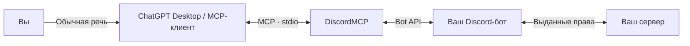

<div align="center">

# DiscordMCP

### Ваш сервер. Ваш бот. Управление обычными словами.

**Русский** · [English](README.en.md)


[](https://nodejs.org/)
[](https://modelcontextprotocol.io/)
[](LICENSE)
[](https://discord.com/developers/applications)

Подключите созданного вами Discord-бота к ChatGPT Desktop, Codex или другому MCP-клиенту — и управляйте сервером через ассистента.

</div>

## Как это работает

**DiscordMCP — мост между ИИ-ассистентом и официальным Discord API.** Вы создаёте своего бота, приглашаете его на сервер и сохраняете токен локально. Мост предоставляет ассистенту инструменты для действий от имени этого бота.



У бота не должно быть заранее написанных команд или собственной логики: достаточно Discord application и Bot Token. Для REST-действий Gateway не нужен; для голоса и событий соединение открывается по необходимости. ИИ работает в вашем MCP-клиенте. Отдельный ключ OpenAI для DiscordMCP не требуется.

## Что можно попросить

> «Оформи сервер в космическом стиле: предложи категории, названия каналов, цвета ролей, приветствие и правила. Сначала покажи план.»

> «Посмотри текущие каналы и роли. Предложи аккуратное оформление без удаления старого контента и изменения прав доступа.»

> «Создай канал объявлений и красиво оформи правила через embed. Используй welcome.png из папки assets.»

| Область | Возможности |
| --- | --- |
| Оформление | Название, иконка, баннер, роли, цвета, эмодзи, стикеры, welcome screen, onboarding |
| Структура | Категории, текстовые и голосовые каналы, права, форумы, ветки |
| Сообщения | Чтение, поиск, embeds, компоненты, вложения, ответы, закрепления |
| Управление | Участники, роли, timeout, kick/ban, AutoMod, аудит |
| Сообщество | События, опросы, вебхуки, application commands |
| Голос | Подключение, локальное аудио, очередь, пауза, soundboard |

Возможности ограничены правами бота, положением ролей, intents и правилами Discord. Например, баннер доступен только при поддержке со стороны самого сервера.

## 1. Создайте своего бота

1. Откройте [Discord Developer Portal](https://discord.com/developers/applications) → **New Application**.
2. На странице **Bot** создайте бота, если он ещё не создан, и получите **Bot Token**. Нужен токен бота, не Client Secret и не токен личного аккаунта.
3. Включите **Message Content Intent**, если хотите читать сообщения, и **Server Members Intent**, если нужны списки участников. Эти настройки также включаются в `.env`.
4. Через раздел установки / OAuth2 пригласите бота на свой сервер со scope `bot`; для application commands добавьте `applications.commands`.
5. Выдайте права под задачу. Для оформления обычно нужны управление сервером, каналами, ролями и выражениями, отправка сообщений и embeds. Права модерации и вебхуков выдаются отдельно.
6. Поставьте роль бота выше ролей, которыми он должен управлять. Владельцем сервера и равными или более высокими ролями бот управлять не сможет.
7. В Discord включите **Настройки → Расширенные → Режим разработчика** и скопируйте ID сервера.

## 2. Установите мост

Требуются **Node.js 22.12+**, npm и Git.

```sh
git clone https://github.com/JeamDev/DiscordMCP.git
cd DiscordMCP
npm ci
npm run build
```

**На Windows** можно запустить мастер:

```powershell
npm run setup
```

Он запросит токен скрытым вводом, проверит его через Discord, сохранит `.env` и предложит регистрацию MCP через установленный Codex CLI. Встроенная ссылка приглашения запрашивает Administrator для полного управления: проверьте права и уменьшите их, если вашей задаче это не нужно. Уже приглашённого бота повторно приглашать не требуется.

**На любой ОС** доступна ручная настройка. Скопируйте `.env.example` в `.env`:

```powershell
# Windows PowerShell
Copy-Item .env.example .env
```

```sh
# macOS / Linux
cp .env.example .env
```

Откройте `.env` локальным редактором и замените заглушки:

```dotenv
DISCORD_BOT_TOKEN=YOUR_BOT_TOKEN
DISCORD_GUILD_ID=YOUR_SERVER_ID
DISCORD_ALLOWED_GUILD_IDS=YOUR_SERVER_ID
DISCORD_MESSAGE_CONTENT=true
DISCORD_GUILD_MEMBERS=true
```

Токен не нужно отправлять ассистенту в чат или указывать в конфигурации MCP-клиента: приложение читает `.env` из своей папки. Этот файл исключён из Git. Если intents не нужны или не включены в Developer Portal, оставьте соответствующие значения `false`.

## 3. Подключите ChatGPT Desktop / Codex

Откройте **Settings → MCP servers → Add server**, выберите **STDIO**:

| Поле | Значение |
| --- | --- |
| Name | `discord-control` |
| Command | `node` или полный путь к `node.exe` |
| Arguments | Один аргумент: полный путь к `DiscordMCP/dist/index.js` |

Сохраните и нажмите **Restart**. Мастер Windows может выполнить регистрацию автоматически; отдельно она доступна через `npm run register`.

Либо используйте CLI:

```sh
codex mcp add discord-control -- node /absolute/path/DiscordMCP/dist/index.js
```

Путь должен быть абсолютным; пути с пробелами заключайте в кавычки. Поддерживаемые локальные клиенты одного Codex-host используют общую MCP-конфигурацию. [Официальная инструкция OpenAI](https://learn.chatgpt.com/docs/extend/mcp).

**ChatGPT в браузере:** этот проект предоставляет локальный `stdio`, не публичный HTTP endpoint. Веб-версия не читает локальный `config.toml`; облачному чату нужны доступные ему plugin/remote MCP tools. Инструкция выше относится к локальному desktop-host. [Область поддержки](https://learn.chatgpt.com/docs/extend/mcp).

<details>
<summary>Другой MCP-клиент с JSON-конфигурацией</summary>

```json
{
  "mcpServers": {
    "discord-control": {
      "command": "node",
      "args": ["/absolute/path/DiscordMCP/dist/index.js"]
    }
  }
}
```

Формат зависит от клиента. В Windows JSON-путях используйте `/` или экранированные `\\`.

</details>

## 4. Начните работу

```sh
npm run doctor
```

Попросите ассистента: **«Проверь подключение DiscordMCP и покажи доступные серверы. Пока ничего не меняй.»** Затем опишите задачу обычными словами.

Для справки доступны `discord_status`, `discord_help` и ресурс `discord://catalog`. Без токена MCP тоже запускается для диагностики; операции Discord вернут ошибку настройки.

<details>
<summary>Прямой вызов инструментов</summary>

Получить схему через `discord_help`:

```json
{"group":"channels","action":"create"}
```

Вызвать `discord_channels`:

```json
{
  "action": "create",
  "params": {"guild_id": "123456789012345678"},
  "body": {"name": "welcome", "type": 0, "topic": "Start here"},
  "reason": "Approved server design"
}
```

Все snowflake ID и битовые права передаются строками. Упоминания отключены по умолчанию. Файлы берутся из `assets/`; выход за пределы папки, в том числе через symlink, блокируется.

</details>

## Настройки

| Переменная | Назначение |
| --- | --- |
| `DISCORD_BOT_TOKEN` | Токен созданного вами бота |
| `DISCORD_GUILD_ID` | Сервер по умолчанию |
| `DISCORD_ALLOWED_GUILD_IDS` | Разрешённые серверы через запятую; пусто — все доступные боту |
| `DISCORD_ASSET_DIR` | Папка изображений, вложений и аудио; по умолчанию `./assets` |
| `DISCORD_MESSAGE_CONTENT` | Содержимое сообщений, по умолчанию `false` |
| `DISCORD_GUILD_MEMBERS` | Intent участников, по умолчанию `false` |
| `DISCORD_EVENT_BUFFER_SIZE` | Буфер событий: 10–2000, по умолчанию 200 |

Окружение процесса имеет приоритет над `.env`. После изменений перезапустите MCP. При заданном allowlist глобальные изменения профиля и приложения блокируются, чтобы не затронуть другие серверы.

## Если что-то не работает

| Симптом | Что проверить |
| --- | --- |
| `401` | Правильный Bot Token и перезапуск MCP после изменения |
| `403` | Права бота и канала, положение ролей, intents |
| Сервер не найден | ID сервера, приглашение бота, allowlist |
| Сообщения не читаются | Message Content Intent в Developer Portal и `.env` |
| Нет инструментов в чате | Абсолютный путь к сборке, доступность Node.js, Restart MCP |
| `429` | Дождитесь снятия rate limit; не повторяйте успешные изменения |

## Границы и безопасность

Используются только официальные bot accounts. Токены личных аккаунтов и self-bot не поддерживаются. Мост проверяет серверный allowlist, ограничивает файлы и скрывает токены в результатах. Подтверждения опасных действий настраиваются в MCP-клиенте; сам мост не является отдельной системой согласования.

Запрошенные сообщения и сведения о сервере возвращаются вашему ИИ-клиенту. Выдавайте боту доступ только к нужным каналам. Не публикуйте `.env`, токены и приватную переписку. [Безопасность](SECURITY.md).

## Разработка

```sh
npm run check
```

TypeScript и 22 офлайн-теста: MCP handshake, `stdio`, каталог операций, изоляция серверов, файлы, скрытие секретов и аудио. Токен не требуется; живой Discord не изменяется.

Стек: TypeScript · MCP SDK · Discord.js · Zod · FFmpeg.

## Лицензия

[MIT](LICENSE) — код можно свободно использовать, изменять и распространять, в том числе в коммерческих проектах, с сохранением уведомления об авторских правах и текста лицензии. Зависимости сохраняют собственные лицензии.

Обложка — концептуальная иллюстрация, не интерфейс продукта.
